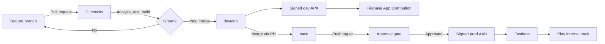

# Flutter Todo App with CI/CD

A simple offline todo app (Flutter, Riverpod, Hive) built to demonstrate an end-to-end mobile CI/CD pipeline: automated checks on every pull request, builds delivered to testers on merge, and tag-based releases to the Google Play internal track with a manual approval gate.

<!-- Add badge: replace OWNER/REPO -->


## Tech stack

- **App:** Flutter, Riverpod, Hive (local storage)
- **CI/CD:** GitHub Actions, Fastlane, Firebase App Distribution, Google Play (internal testing)
- **Environments:** `dev`, `uat`, `prod` Android flavors with separate app IDs

## Pipeline overview



## Workflows

| Workflow | Trigger | What it does |
|---|---|---|
| `ci.yml` | Pull request to `main` / `develop` | `flutter analyze`, `flutter test --coverage`, debug build of the dev flavor |
| `deploy-dev.yml` | Push to `develop` | Builds a signed dev APK and sends it to testers via Firebase App Distribution |
| `release-internal.yml` | Push a tag `v*` (or manual run) | Waits for approval, builds a signed prod AAB, uploads it to the Play internal track with Fastlane |
| `build-android.yml` | Manual only | Builds a signed prod AAB as a downloadable artifact |

## Key design decisions

- **Flavors:** `dev`, `uat` and `prod` use different application IDs (`.dev`, `.uat` suffixes), so all three can be installed on one device.
- **Signing:** the release keystore is stored base64-encoded in GitHub Secrets. CI rebuilds the keystore and `key.properties` at build time, so no signing material is in the repo.
- **Versioning:** the version name comes from the git tag (`v1.2.0` becomes `1.2.0`). The version code is derived from the workflow run number, so it always increases and Play never rejects a duplicate.
- **Approval gate:** production releases use a GitHub Environment (`production`) with a required reviewer, so a tag alone can't ship a build.
- **Pinned toolchain:** the Flutter version is pinned in every workflow so builds are reproducible.
- **Branch protection:** pull requests into `develop` require the CI check to pass.

## Branching model

- `feature/*` branches merge into `develop` through pull requests.
- `develop` is the integration branch and produces dev builds.
- `main` is for releases. Tags are created on `main`.

## Secrets used

| Secret | Purpose |
|---|---|
| `KEYSTORE_BASE64` | Release keystore, base64 encoded |
| `KEYSTORE_PASSWORD`, `KEY_PASSWORD`, `KEY_ALIAS` | Keystore credentials |
| `FIREBASE_APP_ID_DEV` | Firebase app ID for the dev flavor |
| `FIREBASE_SERVICE_ACCOUNT_JSON` | Service account for Firebase App Distribution |
| `PLAY_SERVICE_ACCOUNT_JSON` | Service account for Google Play uploads |

## Running locally

```bash
flutter pub get
flutter test

# Run a flavor
flutter run --flavor dev -t lib/main_dev.dart
flutter run --flavor uat -t lib/main_uat.dart
flutter run --flavor prod -t lib/main_prod.dart
```

## Releasing

```bash
git checkout main
git pull
git tag v1.2.0
git push origin v1.2.0
```

Then approve the pending deployment in the GitHub Actions run. The build is uploaded to the Play internal testing track.

## What I learned

- Handling Android signing safely in CI.
- Why mobile pipelines differ from web: signing, store rules and version codes.
- Keeping pipelines reproducible by pinning tool versions.
- Gating production releases with environments and approvals.